# NestMate Relational Database Entity-Relationship (ER) Model

This document outlines the complete relational data architecture of **NestMate** implemented on **PostgreSQL 18.4** (`nestmate_db`), comprising **18 normalized tables**, 29 foreign key relationships, 25 CHECK domain constraints, and 35 indexes.

---

## 1. System-Wide Entity Relationship Diagram (Mermaid)

```mermaid
erDiagram
    USERS ||--|| ROOMMATE_PREFERENCES : "has 1:1"
    USERS ||--|| NOTIFICATION_PREFERENCES : "configures 1:1"
    USERS ||--|| PRIVACY_SETTINGS : "controls 1:1"
    USERS ||--o{ ACCOMMODATIONS : "owns / hosts (1:N)"
    USERS ||--o{ BOOKING_REQUESTS : "sends (1:N)"
    USERS ||--o{ BOOKING_REQUESTS : "receives as owner (1:N)"
    USERS ||--o{ CONNECTION_REQUESTS : "sends (1:N)"
    USERS ||--o{ CONNECTION_REQUESTS : "receives (1:N)"
    USERS ||--o{ SAVED_ACCOMMODATIONS : "bookmarks (1:N)"
    USERS ||--o{ SAVED_ROOMMATES : "saves as user (1:N)"
    USERS ||--o{ SAVED_ROOMMATES : "saved as target (1:N)"
    USERS ||--o{ REVIEWS : "authors (1:N)"
    USERS ||--o{ REVIEWS : "subject of review (1:N)"
    USERS ||--o{ CONVERSATIONS : "participates as user1 (1:N)"
    USERS ||--o{ CONVERSATIONS : "participates as user2 (1:N)"
    USERS ||--o{ MESSAGES : "sends (1:N)"
    USERS ||--o{ MESSAGES : "receives (1:N)"
    USERS ||--o{ NOTIFICATIONS : "receives (1:N)"
    USERS ||--o{ USER_BLOCKS : "initiates block (1:N)"
    USERS ||--o{ USER_BLOCKS : "is blocked (1:N)"
    USERS ||--o{ USER_REPORTS : "files report (1:N)"
    USERS ||--o{ USER_REPORTS : "is reported (1:N)"

    ACCOMMODATIONS ||--o{ ACCOMMODATION_AMENITIES : "features (1:N)"
    AMENITIES ||--o{ ACCOMMODATION_AMENITIES : "catalogued in (1:N)"
    ACCOMMODATIONS ||--o{ VIRTUAL_TOUR_SCENES : "has 360 scenes (1:N)"
    ACCOMMODATIONS ||--o{ BOOKING_REQUESTS : "targeted by (1:N)"
    ACCOMMODATIONS ||--o{ SAVED_ACCOMMODATIONS : "bookmarked in (1:N)"
    ACCOMMODATIONS ||--o{ REVIEWS : "evaluated in (1:N)"

    CONVERSATIONS ||--o{ MESSAGES : "contains (1:N)"

    USERS {
        VARCHAR_64 id PK
        VARCHAR_120 full_name
        VARCHAR_255 email UK
        VARCHAR_255 password_hash
        VARCHAR_20 account_status "active|deactivated"
        INT auth_version ">=0"
        VARCHAR_500 photo_path
        VARCHAR_100 occupation
        VARCHAR_100 city
        TEXT bio
        VARCHAR_30 phone
        TIMESTAMPTZ created_at
        TIMESTAMPTZ updated_at
    }

    ROOMMATE_PREFERENCES {
        VARCHAR_64 user_id PK, FK "-> users.id"
        NUMERIC_10_2 min_budget ">=0"
        NUMERIC_10_2 max_budget ">=min_budget"
        VARCHAR_100 preferred_area
        VARCHAR_20 sleep_schedule "early|night|flexible|early-bird|night-owl|late"
        VARCHAR_20 food_habits "vegetarian|non-vegetarian|vegan|any"
        VARCHAR_20 cleanliness "low|moderate|medium|high"
        VARCHAR_20 smoking "no|yes|outside|never|socially|regularly"
        VARCHAR_20 drinking "never|socially|regularly|no|yes"
        VARCHAR_20 pets "no|yes|dogs_only|cats_only|not-specified|none|dog|cat|any"
        TIMESTAMPTZ created_at
        TIMESTAMPTZ updated_at
    }

    ACCOMMODATIONS {
        VARCHAR_64 id PK
        VARCHAR_64 owner_id FK "-> users.id"
        VARCHAR_200 title
        TEXT description
        VARCHAR_100 city
        VARCHAR_100 preferred_area
        VARCHAR_50 type "shared_room|private_room|entire_apartment|pg|flat|apartment"
        NUMERIC_10_2 monthly_rent ">0"
        NUMERIC_10_2 security_deposit ">=0"
        INT available_rooms ">=1"
        DATE available_from
        VARCHAR_20 status "available|booked|inactive"
        TEXT_ARRAY photo_urls
        BOOLEAN has_virtual_tour
        TIMESTAMPTZ created_at
        TIMESTAMPTZ updated_at
    }

    AMENITIES {
        SERIAL id PK
        VARCHAR_50 name UK
        VARCHAR_50 icon
    }

    ACCOMMODATION_AMENITIES {
        VARCHAR_64 accommodation_id PK, FK "-> accommodations.id"
        INT amenity_id PK, FK "-> amenities.id"
    }

    VIRTUAL_TOUR_SCENES {
        VARCHAR_64 id PK
        VARCHAR_64 accommodation_id FK "-> accommodations.id"
        VARCHAR_100 room_name
        TEXT panorama_url
        BOOLEAN is_default
        NUMERIC_6_2 yaw
        NUMERIC_6_2 pitch
        JSONB hotspots
        TIMESTAMPTZ created_at
    }

    BOOKING_REQUESTS {
        VARCHAR_64 id PK
        VARCHAR_64 sender_id FK "-> users.id"
        VARCHAR_64 owner_id FK "-> users.id"
        VARCHAR_64 listing_id FK "-> accommodations.id"
        VARCHAR_20 status "pending|accepted|rejected|cancelled"
        DATE move_in_date
        TEXT message
        TIMESTAMPTZ created_at
        TIMESTAMPTZ updated_at
    }

    CONNECTION_REQUESTS {
        VARCHAR_64 id PK
        VARCHAR_64 sender_id FK "-> users.id"
        VARCHAR_64 receiver_id FK "-> users.id"
        VARCHAR_20 status "pending|accepted|rejected|cancelled"
        TIMESTAMPTZ created_at
        TIMESTAMPTZ updated_at
    }

    SAVED_ACCOMMODATIONS {
        VARCHAR_64 user_id PK, FK "-> users.id"
        VARCHAR_64 listing_id PK, FK "-> accommodations.id"
        TIMESTAMPTZ created_at
    }

    SAVED_ROOMMATES {
        VARCHAR_64 user_id PK, FK "-> users.id"
        VARCHAR_64 roommate_id PK, FK "-> users.id"
        TIMESTAMPTZ created_at
    }

    REVIEWS {
        VARCHAR_64 id PK
        VARCHAR_64 reviewer_id FK "-> users.id"
        VARCHAR_20 target_type "roommate|accommodation"
        VARCHAR_64 target_user_id FK "-> users.id (nullable)"
        VARCHAR_64 target_accommodation_id FK "-> accommodations.id (nullable)"
        INT rating "1-5"
        TEXT comment
        VARCHAR_100 interaction_key UK
        TIMESTAMPTZ created_at
        TIMESTAMPTZ updated_at
    }

    CONVERSATIONS {
        VARCHAR_64 id PK
        VARCHAR_64 user1_id FK "-> users.id"
        VARCHAR_64 user2_id FK "-> users.id"
        TIMESTAMPTZ created_at
    }

    MESSAGES {
        VARCHAR_64 id PK
        VARCHAR_64 conversation_id FK "-> conversations.id"
        VARCHAR_64 sender_id FK "-> users.id"
        VARCHAR_64 receiver_id FK "-> users.id"
        TEXT content
        BOOLEAN is_read
        TIMESTAMPTZ created_at
    }

    NOTIFICATIONS {
        VARCHAR_64 id PK
        VARCHAR_64 recipient_id FK "-> users.id"
        VARCHAR_50 type
        VARCHAR_200 title
        TEXT body
        VARCHAR_64 related_request_id
        BOOLEAN is_read
        TIMESTAMPTZ created_at
    }

    NOTIFICATION_PREFERENCES {
        VARCHAR_64 user_id PK, FK "-> users.id"
        BOOLEAN new_requests
        BOOLEAN messages
        BOOLEAN status_updates
        BOOLEAN email_alerts
        BOOLEAN push_notifications
        BOOLEAN connection_requests
        BOOLEAN connection_updates
        BOOLEAN booking_updates
        BOOLEAN review_updates
        BOOLEAN match_recommendations
        TIMESTAMPTZ updated_at
    }

    PRIVACY_SETTINGS {
        VARCHAR_64 user_id PK, FK "-> users.id"
        BOOLEAN show_profile
        BOOLEAN show_phone
        BOOLEAN show_email
        BOOLEAN show_budget
        BOOLEAN show_lifestyle
        BOOLEAN allow_requests
        BOOLEAN allow_connection_requests
        TIMESTAMPTZ updated_at
    }

    USER_BLOCKS {
        VARCHAR_64 owner_id PK, FK "-> users.id"
        VARCHAR_64 blocked_user_id PK, FK "-> users.id"
        TIMESTAMPTZ created_at
    }

    USER_REPORTS {
        VARCHAR_64 id PK
        VARCHAR_64 reporter_id FK "-> users.id"
        VARCHAR_64 reported_user_id FK "-> users.id"
        VARCHAR_50 category
        TEXT reason
        TIMESTAMPTZ created_at
    }
```

---

## 2. Table Cardinality & Relationship Breakdown

| Parent Table | Child Table | Relationship Type | Foreign Key Column(s) | Business Rule / Constraint |
| :--- | :--- | :---: | :--- | :--- |
| `users` | `roommate_preferences` | **1 : 1** | `user_id` (PK & FK) | Each user has at most one preferences profile; deleted on cascade. |
| `users` | `notification_preferences` | **1 : 1** | `user_id` (PK & FK) | Notification toggles per user account. |
| `users` | `privacy_settings` | **1 : 1** | `user_id` (PK & FK) | Visibility controls per user account. |
| `users` | `accommodations` | **1 : N** | `owner_id` | A user can list multiple housing properties. |
| `accommodations` | `virtual_tour_scenes` | **1 : N** | `accommodation_id` | One accommodation can contain multiple 360° panoramic rooms. |
| `accommodations` | `amenities` | **M : N** | Via `accommodation_amenities` | Junction table resolves many-to-many amenities catalog. |
| `users` | `booking_requests` | **1 : N** | `sender_id`, `owner_id` | `CHECK (sender_id <> owner_id)` prevents self-booking. |
| `accommodations` | `booking_requests` | **1 : N** | `listing_id` | Partial unique index prevents duplicate pending requests. |
| `users` | `connection_requests` | **1 : N** | `sender_id`, `receiver_id` | `CHECK (sender_id <> receiver_id)` prevents self-connection. |
| `users` | `accommodations` | **M : N** | Via `saved_accommodations` | Composite PK `(user_id, listing_id)` prevents duplicate bookmarks. |
| `users` | `users` | **M : N** | Via `saved_roommates` | Composite PK `(user_id, roommate_id)` with `CHECK (user_id <> roommate_id)`. |
| `users` | `reviews` | **1 : N** | `reviewer_id` | Authored reviews. Unique `interaction_key` prevents spamming. |
| `users` / `accommodations` | `reviews` | **Polymorphic** | `target_user_id`, `target_accommodation_id` | CHECK constraint enforces target_type matches exactly one non-null target. |
| `users` | `conversations` | **N : N** | `user1_id`, `user2_id` | Canonical ordering `CHECK (user1_id < user2_id)` guarantees uniqueness. |
| `conversations` | `messages` | **1 : N** | `conversation_id` | Linear threaded messaging log indexed by `(conversation_id, created_at)`. |
| `users` | `notifications` | **1 : N** | `recipient_id` | Event-driven notifications with unread indexing. |
| `users` | `user_blocks` | **M : N** | `owner_id`, `blocked_user_id` | Bidirectional privacy blocking; prevents self-blocking. |
| `users` | `user_reports` | **1 : N** | `reporter_id`, `reported_user_id` | Community moderation tickets with category taxonomy. |

---

## 3. Structural Integrity Constraints

1. **Entity Integrity**: All 18 tables define explicit single or composite primary keys (`PRIMARY KEY`).
2. **Referential Integrity**: All 29 foreign keys enforce `ON DELETE CASCADE` to guarantee that orphaned records cannot exist when a root entity is expunged.
3. **Domain Integrity (CHECK constraints)**:
   - Budget: `min_budget >= 0` and `max_budget >= min_budget`.
   - Rent: `monthly_rent > 0` and `security_deposit >= 0`.
   - Room Availability: `available_rooms >= 1`.
   - Ratings: `rating BETWEEN 1 AND 5`.
   - Identity Anti-Reflexivity: `sender_id <> owner_id`, `sender_id <> receiver_id`, `owner_id <> blocked_user_id`.
   - Enums: Standardized text lookups for sleep schedule, cleanliness, smoking, drinking, pet tolerance, and account statuses.
